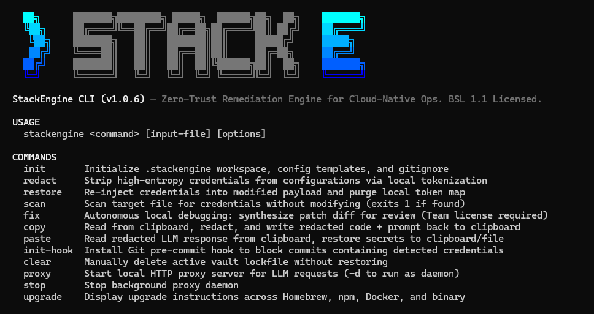

# StackEngine CLI

[](https://www.npmjs.com/package/stackengine)
[](./LICENSE)
[](https://github.com/gweisec/stackengine/actions/workflows/ci.yml)



> **Zero-Trust Remediation Engine for Cloud-Native Ops.**  
> A client-side WASM/Regex engine that locally redacts secrets before LLM exposure, extending to Maker-Checker PR drafting in commercial editions.

StackEngine eliminates cognitive fatigue and credential exfiltration risks in cloud-native operations. It ends the manual "meat proxy" loop of copying, redacting, and pasting sensitive logs, manifests, and Terraform files between terminal sessions and LLM interfaces.

---

### Installation

**npm**
```bash
npm install -g stackengine
```

**Homebrew (macOS & Linux - Recommended)**
```bash
brew tap gweisec/stackengine
brew install stackengine
# Or in one command:
brew install gweisec/stackengine/stackengine
```

**One-line Standalone Binary Install (macOS / Linux, No Node.js required)**
```bash
curl -fsSL https://raw.githubusercontent.com/gweisec/stackengine/main/install.sh | sh
```

**Prebuilt Tarballs / Zip**
Download standalone binaries directly for Linux (amd64/arm64), macOS (Apple Silicon/Intel), and Windows from [GitHub Releases](https://github.com/gweisec/stackengine/releases).

---

## Quick Start

```bash
# Initialize workspace
stackengine init

# Clipboard workflow (for web chat)
stackengine copy     # Reads clipboard → redacts → writes back
# Paste into chat, get response, copy response
stackengine paste    # Reads clipboard → restores secrets → writes back

# File workflow
# 1. Redact secrets in a configuration file
stackengine redact prod.yaml

# 2. Inspect prod.yaml.redacted and provide it to your LLM / agent. 
#    Receive the LLM's suggested fix as fixed_clean.yaml.

# 3. Restore secrets into the modified configuration
stackengine restore fixed_clean.yaml -o fixed.yaml
```

**Output:**

```text
$ stackengine redact prod.yaml
· Loaded 1 custom redaction rule(s): namespace

◆ StackEngine File Redaction

▶ Tokenized 6 credential(s) from prod.yaml:

  ├─ DB                     : S******! → __SE_DB_7AE203__
  ├─ PEM                    : -******- → __SE_PEM_8C38FB__
  ├─ API                    : s******c → __SE_API_E972E9__
  ├─ AWS                    : w******Y → __SE_AWS_8A68CC__
  ├─ AWS                    : A******E → __SE_AWS_96BCA4__
  └─ CUSTOM                 : p******e → __SE_CUSTOM_FC40CB__

  Artifact         : prod.yaml.redacted
  Vault Lockfile   : ~/.stackengine/vault.lock (0600)
  Latency          : 36.52ms
```

The LLM receives opaque, deterministic tokens like `__SE_AWS_96BCA4__` in place of real values. In normal operation, detected secrets remain on your local machine.

---

## How It Works

```
┌──────────┐     ┌────────────────────────────────────────────────────────┐      ┌──────────────┐
│  IDE /   │────▶│               StackEngine (127.0.0.1)                  │────▶│   LLM API    │
│  Agent   │◀────│                                                        │◀────│  (upstream)  │
└──────────┘     │ Stage 1: Tier0Sentinel (regex short-circuit prefilter) │      └──────────────┘
                 │ Stage 2: Dual-Track Extraction (Sweeper + AST WASM)    │
                 │ Stage 3: IntervalHarmonizer (PEM envelope precedence)  │
                 │ Stage 4: Interval Ordering (descending start offset)   │
                 │ Stage 5: ShadowCaster / InboundGrafter (FNV-1a tokens) │
                 └────────────────────────────────────────────────────────┘
```

StackEngine executes a 5-stage core pipeline to redact secrets from payloads before transmission and restore original values upon return:

1. **Stage 1 (`Tier0Sentinel`)**: A flat single-regex prefilter that performs immediate short-circuiting on benign text, bypassing expensive parsing passes when no secret-like candidates exist.
2. **Stage 2 (Dual-Track Extraction)**:
   - **Channel A (`PreflightSweeper`)**: Regex byte-stream sweep targeting invariant credential signatures (e.g., PEM blocks, AWS `AKIA` prefixes, DSN URIs, inline `password=` assignments).
   - **Channel B (Dual-Engine Scalar Extraction)**: Structural parsing via [Tree-sitter WASM](https://tree-sitter.github.io/tree-sitter/) (`TreeSitterWasmExtractor`) for structured formats (YAML, JSON), with regex fallbacks (`LightweightExtractor`, `GenericScriptExtractor` for Bash/HCL). Extracted scalars are fused via `fuseScalars()` and classified through the `Tier3Oracle` capsule chain.
3. **Stage 3 (`IntervalHarmonizer`)**: Resolves interval overlap and disambiguation. Outer envelope matches (such as PEM/PGP envelopes) take precedence, preventing nested fragments from being double-processed.
4. **Stage 4 (Interval Ordering)**: Sorts redaction intervals by start offset in strict descending order, preventing index drift during in-place string tokenization.
5. **Stage 5 (`ShadowCaster` & `InboundGrafter`)**:
   - `ShadowCaster`: Maps identified credentials to deterministic 32-bit FNV-1a tokens (`__SE_<TYPE>_<HASH6>__`) and registers them in the ephemeral vault.
   - `InboundGrafter`: Inspects returned LLM responses and restores tokens back to original plaintext values, adapting to quote delimiter variations induced by the model.

**Vault Lifecycle**: In proxy mode, state is maintained in an in-memory `Map` capped at 100 entries with a 10-minute sliding TTL and FIFO eviction. Cleaned via standard runtime garbage collection (`Map.delete()`). No secrets are written to disk during proxy operation.

---

## CLI Reference

| Command | Category | Description |
|:---|:---|:---|
| `stackengine proxy --port 8080 --upstream <url> [-d]` | Local Proxy | Start local redaction proxy. `-d` runs as background daemon. |
| `stackengine stop` | Local Proxy | Stop running background proxy daemon. |
| `stackengine redact <file> -o <out>` | Engine | Redact secrets from a file. Token map saved to `.stackengine/vault.lock`. |
| `stackengine restore <file> -o <out>` | Engine | Restore secrets using saved token map, then delete the lockfile. |
| `stackengine scan <file>` | Detection | Scan target file for secrets without modification (Exits `1` if detected). |
| `stackengine fix` | Remediation | Autonomous local debugging: synthesize patch diff for review (Team license required). |
| `stackengine copy` | Clipboard | Redact clipboard contents in-place (for web chat workflows). |
| `stackengine paste [-o <file>]` | Clipboard | Restore secrets from clipboard or write to file. |
| `stackengine init` | Workspace | Create `.stackengine/` workspace with config template and `.gitignore`. |
| `stackengine init-hook` | Git Hook | Install Git pre-commit hook that blocks commits containing detected secrets. |
| `stackengine clear` | Vault | Delete active ephemeral vault lockfile without restoring. |

---

### Clipboard Workflow

For pasting into web-based LLM interfaces (ChatGPT, Claude):

```bash
stackengine copy     # Reads clipboard → redacts → writes back
# Paste into chat, get response, copy response
stackengine paste    # Reads clipboard → restores secrets → writes back
```

Clipboard access utilizes `pbcopy`/`pbpaste` on macOS, `clip.exe` on Windows/WSL, or `xclip`/`wl-clipboard` on Linux.

---

### Pre-commit Hook & Remediation Boundary

StackEngine enforces a strict operational boundary: **Blocking and manual remediation workflows are free; automated patch drafting is paid.**

```bash
stackengine init-hook
```

Staged files are scanned on `git commit`. If plaintext credentials are discovered, the commit is intercepted:

```text
▶ Scanning staged files for hardcoded credentials...
· Loaded 1 custom redaction rule(s): namespace

× Credentials detected: 2 exposed in infra/helm/values.yaml

  ├─ DB                     : _******_ → __SE_DB_9ECC50__
  └─ CUSTOM                 : p******e → __SE_CUSTOM_FC40CB__

× Commit blocked: Hardcoded credentials detected in staged files
  Policy: Plaintext credentials must not be committed to version control.

  ▶ Autonomous local fix    : stackengine fix <file> (Team license required)
  ▶ Manual local redaction   : stackengine redact <file>
  · Emergency gate bypass   : git commit --no-verify (audited)
```

Running `stackengine fix` triggers Autonomous Local Debugging, matching 500+ expert diagnostic matrices to synthesize a local patch draft and output a highlighted unified diff for developer sign-off.

---

### Proxy Mode Setup

Start the proxy and point your AI client at the local loopback interface:

```bash
stackengine proxy --port 8080 --upstream https://api.openai.com -d
```

| Client | Configuration |
|--------|---------------|
| **Cursor IDE** | `Settings` → `Models` → `OpenAI Base URL` → `http://127.0.0.1:8080/v1` |
| **Python SDK** | `client = OpenAI(base_url="http://127.0.0.1:8080/v1")` |
| **Shell** | `export OPENAI_BASE_URL=http://127.0.0.1:8080/v1` |

> **Note:** The proxy operates against OpenAI-compatible APIs. It functions with any provider conforming to the standard request schema (OpenRouter, Together, local Ollama, etc.) by adjusting `--upstream`.

---

### Docker Deployment

Run StackEngine as a containerized gateway without requiring a local Node.js runtime.

Official multi-architecture images (`linux/amd64` and `linux/arm64`) are published to:
- **Docker Hub:** `stackenginehq/stackengine:latest`
- **GitHub Container Registry (GHCR):** `ghcr.io/stackenginehq/stackengine:latest`

#### Quick Start (Docker Run)

```bash
docker run -d \
  --name stackengine \
  -p 8080:8080 \
  -e STACKENGINE_PORT=8080 \
  -e STACKENGINE_UPSTREAM=https://api.openai.com \
  --restart unless-stopped \
  stackenginehq/stackengine:latest
```

#### Docker Compose

```yaml
version: '3.8'

services:
  stackengine:
    image: stackenginehq/stackengine:latest
    container_name: stackengine-gateway
    ports:
      - "8080:8080"
    environment:
      - STACKENGINE_PORT=8080
      - STACKENGINE_UPSTREAM=https://api.openai.com
    restart: unless-stopped
```

#### Ad-hoc Scanning (CLI Utility)

Run one-off security scans on repository files without host installation:

```bash
docker run --rm -v $(pwd):/workspace -w /workspace stackenginehq/stackengine:latest scan /workspace/prod.yaml
```

---

## Custom Redaction Rules

By default, StackEngine targets standard credential patterns (AWS keys, GCP tokens, PEM blocks, database URIs, high-entropy strings). To specify organization-specific keys:

```bash
stackengine init
```

Then edit `.stackengine/config.yaml`:

```yaml
# .stackengine/config.yaml
customIntentKeys:
  - "corp_auth_pin"
  - "metadata.namespace"
```

Keys listed here are evaluated via AST path resolution. If a key context matches, it takes priority over the default allowlist and marks the scalar for redaction (excluding template variables such as `$VAR` or `${VAR}`).

---

## Threat Model & Limitations

StackEngine provides client-side secret redaction and establishes a local trust boundary; it is not a formal cryptographic boundary.

**What this is:** A local, opt-in interceptor that catches plaintext credential patterns before they reach an LLM API.

**What this is NOT:** A replacement for secrets managers (HashiCorp Vault, AWS Secrets Manager), credential rotation systems, or proper RBAC. It does not provide formal mathematical guarantees against adversarial payload steganography.

**Known boundaries & limitations:**

- **Heuristic coverage is bounded.** Non-standard formats or heavily obfuscated payloads can bypass heuristic passes. Use `customIntentKeys` to close gaps specific to internal infrastructure.
- **Opt-in, not global egress capture.** StackEngine only processes traffic that clients explicitly route to `127.0.0.1`. It does not perform kernel-level egress capture and does not inspect unrouted system processes.
- **Local loopback interface.** The proxy listens on `http://127.0.0.1`. Communication between local clients and the loopback port is unencrypted plaintext HTTP.
- **Userspace execution.** StackEngine runs as a standard Node.js userspace process without SGX, TEE, or kernel-level memory sealing.
- **Stream demotion in proxy.** Intercepted streaming requests (`stream: true`) are demoted to `stream: false` when forwarded upstream. Re-synthesized SSE chunks are transmitted to the client only after complete response reception and token restoration, preventing cross-chunk token corruption.
- **Bounded in-memory vault.** The vault holds a maximum of 100 token mappings with a 10-minute sliding TTL. Eviction operates via FIFO, and deleted entries rely on standard V8 garbage collection (`Map.delete()`).

---

## How StackEngine Differs from Existing Tools

| Dimension | StackEngine | Gitleaks / TruffleHog | Detect-Secrets |
|:---|:---|:---|:---|
| **Primary Paradigm** | **Active Remediation Engine** | Passive Static Scanner | Audit Scanner |
| **Execution Phase** | Real-time LLM streams + Pre-commit + CI/CD | Pre-commit hook or CI scan | Pre-commit hook or audit |
| **Action on Detection**| Tokenizes, proxies, restores (Community); generates PRs (Team license required) | Emits alert & exits non-zero | Emits alert & exits non-zero |
| **LLM Syntax Awareness**| Yes (AST token preservation & quote restoration) | No | No |
| **Automated PR Generation** | **Yes** (Commercial Maker-Checker PR Pipeline) | No (Manual engineer intervention) | No (Manual engineer intervention) |
| **Complementary Use**  | Use StackEngine for active workflows; use Gitleaks for historical repo scans | — | — |

Traditional scanners operate as read-only alert mechanisms that halt builds and demand manual intervention. StackEngine is built as an **active stateful tokenization engine** designed for live LLM workflows, extending to automated PR generation governed by Maker-Checker review.

---

## API / Library Usage

StackEngine exports its redaction engine as an importable library:

```typescript
import { HybridRedactor } from 'stackengine';

const redactor = new HybridRedactor();

const { sanitized, tokenMap } = await redactor.redact(
  rawYaml,
  'generic',        // language hint
  './node_modules/stackengine/dist/wasm'  // tree-sitter WASM directory
);

// sanitized: string with secrets replaced by __SE_*__ tokens
// tokenMap: Record<string, string> mapping tokens → original values
```

---

## Architecture Details

<details>
<summary>Expand for implementation details</summary>

### Regex Safety

All regex rules use flat, non-nested quantifiers to prevent catastrophic backtracking. No patterns of the form `(a+)+` or `(a|b)*` exist in the rule set. This is validated against 1MB+ obfuscated payloads during wind-tunnel testing.

### Stream Handling

When the proxy intercepts a streaming (`stream: true`) request, it demotes the request to non-streaming (`stream: false`) before forwarding to the upstream API. This ensures the complete response is available for token restoration without partial-match errors across SSE chunk boundaries. After restoration, the proxy re-synthesizes SSE frames and delivers them back to the client as a streaming response.

### Token Format

Tokens follow the pattern `__SE_<TYPE>_<HASH6>__` where `<TYPE>` is a compressed semantic label (e.g., `AWS`, `DB`, `PEM`) and `<HASH6>` is a 6-character deterministic 32-bit FNV-1a hash. Identical secrets in multi-message payloads always resolve to identical tokens.

### Vault Lifecycle

- **Proxy mode:** In-memory `Map` with 100-entry cap, FIFO eviction, and 10-minute sliding TTL. Entries expire after 10 minutes of inactivity.
- **File mode:** Token map persisted to `.stackengine/vault.lock` (mode `0600`). Purged immediately following `stackengine restore`.

</details>

---

## Contributing

```bash
git clone https://github.com/gweisec/stackengine.git
cd stackengine
npm install
npm run build       # Builds with tsup → dist/
```

The validation harness is in `scripts/wind-tunnel.ts`. To execute:

```bash
npm run test:windtunnel
```

Found an unhandled credential pattern or grammar edge case? Please [open an issue](https://github.com/gweisec/stackengine/issues) with a sanitized reproduction snippet.

---

## Deployment Topology & Editions

StackEngine is built on a source-available architecture to provide inspectable local redaction and a bounded trust boundary for the community, while offering air-gapped automation for regulated enterprises.

| Tier | Edition | Target Environment | Core Architecture |
| :--- | :--- | :--- | :--- |
| **Layer 1** | **Community** (`stackengine`) | Local Dev / Standalone | Source-available. Pure client-side WASM engine. Local proxy, clipboard redaction, and pre-commit secret blocking. |
| **Layer 2** | **Team** (`CI/CD Automator`) | Engineering Teams | CI/CD runner PR bot & autonomous local debugging (`stackengine fix`). Matches 500+ hardcoded expert diagnostic matrices to draft verified PRs under Maker-Checker review. Native CI/CD step logs. |
| **Layer 3** | **Enterprise** (`Air-Gapped`) | High-Compliance VPCs | 100% air-gapped on-premise Docker deployment. VPC-internal LLM routing (local Ollama / Azure Private Link), distributed Redis vault, and SOC2 SIEM streaming. |

*For automated Maker-Checker PR pipelines and enterprise air-gapped deployments, refer to the [StackEngine Architecture Matrix](https://stackengine.dev).*

---

## License

StackEngine Community Edition is source-available under the [Business Source License 1.1](./LICENSE) (BUSL-1.1), converting to Apache-2.0 two years after each release.

- **Free for:** personal development, internal company workflows, CI/CD pipelines, evaluation, and contributing back to this project.
- **Not permitted:** offering the functionality of StackEngine to third parties as a hosted commercial product, managed service, or competing developer security tooling.
- **Change date:** each version converts automatically to Apache-2.0 two years after its release.

If your automated compliance scanner flags this license, refer to the 1-page pre-approved [Legal Justification Memo](./docs/LEGAL_JUSTIFICATION.md) for compliance review.

### Why BSL 1.1?

StackEngine is maintained as an independent infrastructure project. Permissive licenses (such as MIT or Apache-2.0) allow well-funded entities to fork, rebrand, and distribute closed binaries as competing commercial services without contributing upstream—depriving the core project of sustainability.

BSL 1.1 prevents commercial free-riding while ensuring the codebase remains fully inspectable, auditable, and free for internal organizational use. Every release automatically transitions to Apache-2.0 on a rolling two-year timeline.
