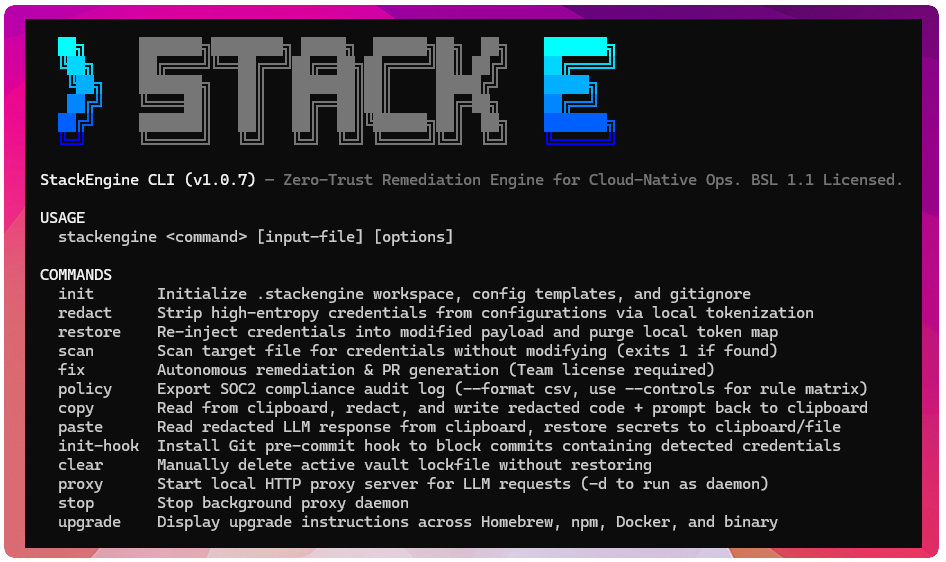

# StackEngine CLI

[](https://www.npmjs.com/package/stackengine)
[](./LICENSE)
[](https://github.com/gweisec/stackengine/actions/workflows/ci.yml)



> **Client-Side AST Secret Redaction & CI/CD Remediation Engine.**  
> Tokenizes sensitive scalars locally before external LLM inference and synthesizes syntax-validated remediation PRs in CI/CD.

When debugging Terraform, Kubernetes, or IAM failures with external LLMs, engineers must manually scrub sensitive ARNs, keys, and state before prompting, then re-insert them afterward. Conversely, piping unverified AI output directly into Git risks leaking credentials or merging unsafe defaults.

StackEngine operates at three enforcement points:

1. **Local Tokenization & In-Place Restoration (`copy/paste` & `redact/restore`)**: Deterministically converts secrets and internal topology into structure-preserving shadow tokens (`__SE_AWS_96BCA4__`) in <50ms (<5ms warm AST pass) via Web-Tree-sitter WASM. Query external LLMs safely, then graft original plaintext values back in-place.
2. **Pre-Commit & Repo-Wide Guardrails (`init-hook` & `.stackengine.yaml`)**: Blocks credential leaks in <50ms before `git commit` and enforces repository-scoped AST redaction policies across developer workstations, code reviewers, and CI runners.
3. **Automated CI/CD Remediation PRs (`stackengine fix`)**: Runs natively inside GitHub Actions / GitLab CI with zero plaintext data egress. Constrains LLM fixes into syntax-validated, minimal-blast-radius Unified Diffs across 500+ IaC & security rules, enforces **Maker-Checker dual-engineer approval**, and attaches a **SHA-256 signed zero-plaintext-egress audit attestation** (for SOC 2 evidence) to every PR.

---

### Installation

**npm**
```bash
npm install -g stackengine
```

**Homebrew (macOS & Linux - Recommended)**
```bash
brew install gweisec/stackengine/stackengine
```

**One-line Standalone Binary Install (macOS / Linux, No Node.js required)**
```bash
curl -fsSL https://raw.githubusercontent.com/gweisec/stackengine/main/install.sh | sh
```

**Prebuilt Tarballs / Zip**
Download standalone binaries directly for Linux (amd64/arm64), macOS (Apple Silicon/Intel), and Windows from [GitHub Releases](https://github.com/gweisec/stackengine/releases).

---

## Quick Start

```bash
# Initialize workspace
stackengine init

# Clipboard workflow (for web chat)
stackengine copy     # Reads clipboard → redacts → writes back
# Paste into chat, get response, copy response
stackengine paste    # Reads clipboard → restores secrets → writes back

# File workflow
# 1. Redact secrets in a configuration file
stackengine redact prod.yaml

# 2. Inspect prod.yaml.redacted and provide it to your LLM / agent. 
#    Receive the LLM's suggested fix as fixed_clean.yaml.

# 3. Restore secrets into the modified configuration
stackengine restore fixed_clean.yaml -o fixed.yaml
```

**Output:**

```text
$ stackengine redact prod.yaml
· Loaded 1 custom redaction rule(s): namespace

◆ StackEngine File Redaction

▶ Tokenized 6 credential(s) from prod.yaml:

  ├─ DB                     : S******! → __SE_DB_7AE203__
  ├─ PEM                    : -******- → __SE_PEM_8C38FB__
  ├─ API                    : s******c → __SE_API_E972E9__
  ├─ AWS                    : w******Y → __SE_AWS_8A68CC__
  ├─ AWS                    : A******E → __SE_AWS_96BCA4__
  └─ CUSTOM                 : p******e → __SE_CUSTOM_FC40CB__

  Artifact         : prod.yaml.redacted
  Vault Lockfile   : .stackengine/vault.lock (0600)
  Latency          : 36.52ms
```

The LLM receives opaque, deterministic tokens like `__SE_AWS_96BCA4__` in place of real values. In normal operation, detected secrets remain on your local machine.

---

## How It Works

```
┌───────────────────────────────┐
│ Sensitive Inputs              │
│ · Clipboard (Web Chat / Logs) │────▶ ┌────────────────────────────────────────────────────────┐      ┌──────────────┐
│ · Cloud Manifests / State     │      │               StackEngine Engine Core                  │────▶│   LLM API    │
│ · CI/CD Runner Staged Diffs   │◀──── │ Stage 1: Tier0Sentinel (regex short-circuit prefilter) │      │ (Web / BYOK) │
└───────────────────────────────┘      │ Stage 2: Dual-Track Extraction (Sweeper + AST WASM)    │◀────└──────────────┘
                                       │ Stage 3: IntervalHarmonizer (PEM envelope precedence)  │
                                       │ Stage 4: Interval Ordering (descending start offset)   │
                                       │ Stage 5: ShadowCaster / InboundGrafter (FNV-1a tokens) │
                                       └────────────────────────────────────────────────────────┘
```

StackEngine executes a 5-stage core pipeline to redact secrets from payloads before transmission and restore original values upon return:

1. **Stage 1 (`Tier0Sentinel`)**: A flat single-regex prefilter that performs immediate short-circuiting on benign text, bypassing expensive parsing passes when no secret-like candidates exist.
2. **Stage 2 (Dual-Track Extraction)**:
   - **Channel A (`PreflightSweeper`)**: Regex byte-stream sweep targeting invariant credential signatures (e.g., PEM blocks, AWS `AKIA` prefixes, DSN URIs, inline `password=` assignments).
   - **Channel B (Dual-Engine Scalar Extraction)**: Structural parsing via [Tree-sitter WASM](https://tree-sitter.github.io/tree-sitter/) (`TreeSitterWasmExtractor`) for hierarchical manifests (YAML, JSON), paired with lexical state-machine extractors (`LightweightExtractor`, `GenericScriptExtractor`) for HCL, Bash, and Dotenv scalar assignments. Extracted scalars are fused via `fuseScalars()` and classified through the `Tier3Oracle` capsule chain.
3. **Stage 3 (`IntervalHarmonizer`)**: Resolves interval overlap and disambiguation. Outer envelope matches (such as PEM/PGP envelopes) take precedence, preventing nested fragments from being double-processed.
4. **Stage 4 (Interval Ordering)**: Sorts redaction intervals by start offset in strict descending order, preventing index drift during in-place string tokenization.
5. **Stage 5 (`ShadowCaster` & `InboundGrafter`)**:
   - `ShadowCaster`: Maps identified credentials to deterministic 32-bit FNV-1a tokens (`__SE_<TYPE>_<HASH6>__`) and registers them in the ephemeral vault.
   - `InboundGrafter`: Inspects returned LLM responses and restores tokens back to original plaintext values, adapting to quote delimiter variations induced by the model.

**Vault Lifecycle**: State is maintained in an ephemeral lockfile (`.stackengine/vault.lock`, mode 0600) for file operations, or in an in-memory `Map` capped at 100 entries with a 10-minute sliding TTL and FIFO eviction for daemon processes. Cleaned via standard runtime garbage collection (`Map.delete()`) or purged immediately upon `restore` / `paste`.

---

## CLI Reference

| Command | Category | Description |
|:---|:---|:---|
| `stackengine redact <file> -o <out>` | Engine | Redact secrets from a file in <50ms. Saves token map to `.stackengine/vault.lock`. |
| `stackengine restore <file> -o <out>` | Engine | Restore original secrets into AI-remediated file and purge lockfile. |
| `stackengine copy` | Clipboard | Redact clipboard contents in-place with compiler prompt directive (for web AI chat). |
| `stackengine paste [-o <file>]` | Clipboard | Restore secrets from AI clipboard response and write back in-place. |
| `stackengine scan <file>` | Detection | Scan target file for credentials without modifying (exits `1` if detected). |
| `stackengine init-hook` | Git Hook | Install <50ms Git pre-commit hook that blocks commits containing detected secrets. |
| `stackengine fix [<file>]` | Remediation | Automated remediation: synthesize local patch diff or CI/CD PR draft (Team license required). |
| `stackengine policy export [--format csv] [--controls]` | Compliance | Export SOC2 operational audit log preview (or pass `--controls` for rule matrix). |
| `stackengine init` | Workspace | Initialize `.stackengine/` workspace with config templates and `.gitignore`. |
| `stackengine clear` | Vault | Manually delete active ephemeral vault lockfile without restoring. |
| `stackengine proxy --port 8080 --upstream <url> [-d]` | Advanced | Optional loopback HTTP proxy for standard OpenAI-compatible scripts and SDKs. |
| `stackengine stop` | Advanced | Stop background proxy daemon. |

---

### Clipboard Workflow

For pasting into web-based LLM interfaces (ChatGPT, Claude):

```bash
stackengine copy     # Reads clipboard → redacts → writes back
# Paste into chat, get response, copy response
stackengine paste    # Reads clipboard → restores secrets → writes back
```

Clipboard access utilizes `pbcopy`/`pbpaste` on macOS, `clip.exe` on Windows/WSL, or `xclip`/`wl-clipboard` on Linux.

---

### Pre-commit Hook & Remediation Boundary

StackEngine enforces a strict operational boundary: **Blocking and manual remediation workflows are free; automated patch drafting is paid.**

```bash
stackengine init-hook
```

Staged files are scanned on `git commit`. If plaintext credentials are discovered, the commit is intercepted:

```text
▶ Scanning staged files for hardcoded credentials...

× Credentials detected: 2 exposed in infra/helm/values.yaml

  ├─ DB                     : _******_ → __SE_DB_9ECC50__
  └─ CUSTOM                 : p******e → __SE_CUSTOM_FC40CB__

× Commit blocked: Hardcoded credentials detected in staged files
  Policy: Plaintext credentials must not be committed to version control.

  ▶ Autonomous local fix    : stackengine fix <file> (Team license required)
  ▶ Manual local redaction   : stackengine redact <file>
  · Emergency gate bypass   : git commit --no-verify (audited)
```

Running `stackengine fix` evaluates the target file against 500+ static AST policy rules (covering AWS IAM, Terraform, Kubernetes RBAC/Secrets, and CI/CD workflows) to synthesize a local patch draft and output a highlighted unified diff for developer sign-off.

---

### Advanced: Local Loopback Gateway (`stackengine proxy`)

For custom automation scripts, Python/Node.js SDKs, or standard OpenAI-compatible tooling:

```bash
stackengine proxy --port 8080 --upstream https://api.openai.com -d
```

| Environment | Configuration |
|:---|:---|
| **Anthropic SDK / Claude CLI** | `export ANTHROPIC_BASE_URL=http://127.0.0.1:8080` |
| **OpenAI-Compatible CLIs** | `export OPENAI_BASE_URL=http://127.0.0.1:8080/v1` |
| **Python / Node.js SDKs** | `baseURL: "http://127.0.0.1:8080/v1"` |
| **cURL / Automation Scripts** | `curl http://127.0.0.1:8080/v1/chat/completions ...` |

> ⚠️ **Operational Boundary Notice**: The loopback proxy is engineered specifically for standard OpenAI/Anthropic-compatible HTTP payloads (using real-time 32-byte sliding window stream grafting). For proprietary IDE internal channels (such as Cursor Composer background agents using private Protobuf) or certificate-pinned runtimes, use the deterministic clipboard (`stackengine copy/paste`) or file workflows (`stackengine redact/restore`) to prevent IDE internal AST schema and offset mismatches.

---

### Docker Deployment

Run StackEngine in isolated containers for CI/CD pipelines, one-off file redaction, or an optional loopback gateway without requiring a local Node.js runtime.

Official multi-architecture images (`linux/amd64` and `linux/arm64`) are published to:
- **Docker Hub:** `stackenginehq/stackengine:latest`
- **GitHub Container Registry (GHCR):** `ghcr.io/stackenginehq/stackengine:latest`

#### 1. Ad-hoc Scanning & Redaction (CI/CD & Local Utility)

Run one-off security scans or file redactions on repository files without host installation:

```bash
# Scan a configuration file
docker run --rm -v $(pwd):/workspace -w /workspace stackenginehq/stackengine:latest scan /workspace/prod.yaml

# Redact credentials before sending to LLM
docker run --rm -v $(pwd):/workspace -w /workspace stackenginehq/stackengine:latest redact /workspace/prod.yaml
```

#### 2. Containerized Gateway (Optional Loopback Daemon)

Run StackEngine as a persistent containerized gateway on port 8080:

```bash
docker run -d \
  --name stackengine \
  -p 8080:8080 \
  -e STACKENGINE_PORT=8080 \
  -e STACKENGINE_UPSTREAM=https://api.openai.com \
  --restart unless-stopped \
  stackenginehq/stackengine:latest
```

##### Docker Compose

```yaml
version: '3.8'

services:
  stackengine:
    image: stackenginehq/stackengine:latest
    container_name: stackengine-gateway
    ports:
      - "8080:8080"
    environment:
      - STACKENGINE_PORT=8080
      - STACKENGINE_UPSTREAM=https://api.openai.com
    restart: unless-stopped
```

---

## Custom Redaction Rules

By default, StackEngine targets standard credential patterns (AWS keys, GCP tokens, PEM blocks, database URIs, high-entropy strings). To specify organization-specific keys:

```bash
stackengine init
```

Then edit `.stackengine/config.yaml`:

```yaml
# .stackengine/config.yaml
customIntentKeys:
  - "corp_auth_pin"
  - "metadata.namespace"
```

Keys listed here are evaluated via AST path resolution. If a key context matches, it takes priority over the default allowlist and marks the scalar for redaction (excluding template variables such as `$VAR` or `${VAR}`).

> **Tier Boundary**: Because `.stackengine/` is automatically git-ignored for local workspace isolation, `.stackengine/config.yaml` remains strictly local to a single machine and loads up to **2 personal custom rules** in Community Edition. To commit and enforce unlimited shared redaction rules across all team branches, code reviewers, and CI/CD runners, define them in the repository root via [`.stackengine.yaml`](https://stackengine.dev/#pricing) (Commercial Team Edition).

---

## Threat Model & Limitations

StackEngine provides client-side secret redaction and establishes a local trust boundary; it is not a formal cryptographic boundary.

**What this is:** A local, opt-in interceptor that catches plaintext credential patterns before they reach an LLM API.

**What this is NOT:** A replacement for secrets managers (HashiCorp Vault, AWS Secrets Manager), credential rotation systems, or proper RBAC. It does not provide formal mathematical guarantees against adversarial payload steganography.

**Known boundaries & limitations:**

- **Heuristic coverage is bounded.** Non-standard formats or heavily obfuscated payloads can bypass heuristic passes. Use `customIntentKeys` to close gaps specific to internal infrastructure.
- **Opt-in, not global egress capture.** StackEngine only processes traffic that clients explicitly route to `127.0.0.1`. It does not perform kernel-level egress capture and does not inspect unrouted system processes.
- **Local loopback interface.** The proxy listens on `http://127.0.0.1`. Communication between local clients and the loopback port is unencrypted plaintext HTTP.
- **Userspace execution.** StackEngine runs as a standard Node.js userspace process without SGX, TEE, or kernel-level memory sealing.
- **Streaming token grafting boundary.** Streaming requests (`stream: true`) preserve upstream SSE streams with <2ms latency overhead via a 32-byte sliding window (`SlidingWindowStreamGrafter`). While this reliably reconstructs tokens split across chunk boundaries, non-standard or heavily mutated token strings mid-stream may pass through unredacted.
- **Bounded in-memory vault.** The vault holds a maximum of 100 token mappings with a 10-minute sliding TTL. Eviction operates via FIFO, and deleted entries rely on standard V8 garbage collection (`Map.delete()`).

---

## How StackEngine Differs from Existing Tools

| Dimension | StackEngine | Gitleaks / TruffleHog | Detect-Secrets |
|:---|:---|:---|:---|
| **Primary Paradigm** | **Bidirectional Tokenizer & Patch Synthesizer** | Read-Only Static Scanner (Exit 1) | Audit Scanner |
| **Execution Phase** | Pre-troubleshooting (Clipboard/File) + Pre-commit + CI/CD PR Pipeline | Pre-commit hook or CI scan | Pre-commit hook or audit |
| **Action on Detection**| Tokenizes, proxies, restores (Community); generates PRs (Team license required) | Emits alert & exits non-zero | Emits alert & exits non-zero |
| **LLM Syntax Awareness**| Yes (AST token preservation & quote restoration) | No | No |
| **Automated PR Generation** | **Yes** (Commercial Maker-Checker PR Pipeline) | No (Manual engineer intervention) | No (Manual engineer intervention) |
| **Complementary Use**  | Use StackEngine for active workflows; use Gitleaks for historical repo scans | — | — |

Traditional scanners (Gitleaks, TruffleHog, Checkov, Trivy) operate as read-only alert mechanisms that halt builds (Exit 1) and demand manual intervention. StackEngine operates as an **active tokenization and remediation layer**: it redacts blocked configs in <50ms for external LLM debugging and generates syntax-validated fix PRs in CI/CD under Maker-Checker governance.

---

## Architecture Details

<details>
<summary>Expand for implementation details</summary>

### Regex Safety

All regex rules use flat, non-nested quantifiers to prevent catastrophic backtracking. No patterns of the form `(a+)+` or `(a|b)*` exist in the rule set. This is validated against 1MB+ obfuscated payloads during wind-tunnel testing.

### Stream Handling

The proxy features real-time SSE streaming detokenization powered by `SlidingWindowStreamGrafter`. Rather than buffering entire responses, outbound chunks pass through a 32-byte sliding window that reconstructs shadow tokens (`__SE_<TYPE>_<HASH6>__`) split across SSE chunk boundaries, restoring plaintext credentials with sub-2ms overhead. Non-streaming requests (`stream: false`) are restored in-place before final HTTP dispatch.

### Token Format

Tokens follow the pattern `__SE_<TYPE>_<HASH6>__` where `<TYPE>` is a compressed semantic label (e.g., `AWS`, `DB`, `PEM`) and `<HASH6>` is a 6-character deterministic 32-bit FNV-1a hash. Identical secrets in multi-message payloads always resolve to identical tokens.

### Vault & Workspace Lifecycle

- **Proxy mode:** In-memory `Map` with 100-entry cap, FIFO eviction, and 10-minute sliding TTL. Entries expire after 10 minutes of inactivity.
- **File mode:** Token map persisted to `.stackengine/vault.lock` (mode `0600`). Purged immediately following `stackengine restore`.
- **Audit ledger:** Local operational events are recorded in `.stackengine/audit.jsonl` (newest records first, capped at a rolling 50-event limit in Community Edition).
- **Workspace isolation:** `.stackengine/` maintains an internal `.gitignore` (`*`), ensuring local runtime artifacts (`proxy.pid`, `proxy.log`, `audit.jsonl`) remain strictly excluded from version control.

</details>

---

## Contributing

```bash
git clone https://github.com/gweisec/stackengine.git
cd stackengine
npm install
npm run build       # Builds with tsup → dist/
```

The validation harness is in `scripts/wind-tunnel.ts`. To execute:

```bash
npm run test:windtunnel
```

Found an unhandled credential pattern or grammar edge case? Please [open an issue](https://github.com/gweisec/stackengine/issues) with a sanitized reproduction snippet.

---

## Deployment Topology & Editions

StackEngine is built on a source-available architecture to provide inspectable local redaction and a bounded trust boundary for the community, while offering air-gapped automation for regulated enterprises.

| Tier | Edition | Target Scope | Core Architecture |
| :--- | :--- | :--- | :--- |
| **Layer 1** | **Community** (`stackengine`) | Individual Workstations & Small Repos (≤3 Committers) | Source-available. Pure client-side WASM engine. Clipboard (`copy`/`paste`), file redaction (`redact`/`restore`), local proxy, pre-commit blocking, and up to 2 local custom rules. |
| **Layer 2** | **Team** (`CI/CD Automator`) | Engineering Teams (Up to 15 Committers / Pack) | Shared repo-level policy (`.stackengine.yaml` with unlimited rules), automated CI/CD remediation PRs (`stackengine fix`) across 500+ AWS IAM/Terraform/K8s rules, **Maker-Checker dual approval**, and **SHA-256 signed zero-plaintext-egress PR attestations** (SOC 2 evidence). |
| **Layer 3** | **Enterprise** (`Air-Gapped`) | Fleet Control (>15 Committers / Regulated VPCs) | 100% air-gapped on-premise Docker deployment. VPC-internal LLM routing (local Ollama / Azure Private Link), distributed Redis vault, and SOC 2 SIEM streaming. |

*For automated Maker-Checker PR pipelines and enterprise air-gapped deployments, refer to the [StackEngine Architecture Matrix](https://stackengine.dev).*

---

## License

StackEngine Community Edition is source-available under the [Business Source License 1.1](./LICENSE) (BUSL-1.1), converting to Apache-2.0 two years after each release.

- **Free for (Community Edition scope):** individual developer workstation workflows—including clipboard tokenization & restoration (`copy`/`paste`), manual file redaction (`redact`/`restore`), local loopback proxy (`proxy`), pre-commit hooks (`init-hook` with ≤2 local custom rules), and standalone secret scanning (`scan`).
- **Commercial License required for:** repository-wide shared policy enforcement (`.stackengine.yaml` or >2 custom rules), automated remediation & PR synthesis (`stackengine fix`), full SOC 2 control matrix exports (`policy export`), and unattended CI/CD execution in repositories exceeding 3 active Git committers (measured over a rolling 30-day window; Team Pack covers 4–15 committers; >15 requires Enterprise). See [Pricing & Editions](https://stackengine.dev/#pricing).
- **Not permitted:** offering the functionality of StackEngine to third parties as a hosted commercial product, managed service, or competing developer security tooling.
- **Change date:** each version converts automatically to Apache-2.0 two years after its release.

If your automated compliance scanner flags this license, refer to the 1-page pre-approved [Legal Justification Memo](./docs/LEGAL_JUSTIFICATION.md) for compliance review.

### Why BSL 1.1?

StackEngine is maintained as an independent infrastructure project. Permissive licenses (such as MIT or Apache-2.0) allow well-funded entities to fork, rebrand, and distribute closed binaries as competing commercial services without contributing upstream—depriving the core project of sustainability.

BSL 1.1 prevents commercial free-riding while ensuring the codebase remains fully inspectable, auditable, and free for internal organizational use. Every release automatically transitions to Apache-2.0 on a rolling two-year timeline.
